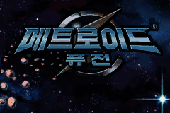

# 메트로이드 퓨전 — 게임보이 어드밴스

게임보이 어드밴스 **메트로이드 퓨전** 한글 번역 패치 프로젝트입니다. 사무스가 우주 연구 시설에서 X에 맞서는 액션 어드벤처 게임입니다.

> **정식 배포 v1.0**

<!-- game-preview:start -->

  

**한글 타이틀 · 작업 당시 캡처** — v24_korean_title_vramsafe Mesen 캡처 작업 당시 화면이며 최종 배포본의 화면 검증을 의미하지 않습니다.
<!-- game-preview:end -->

## 다운로드 및 적용 방법

1. 아래 체크섬 또는 상세 안내와 일치하는 원본을 준비합니다.
2. [최종 배포 패치 다운로드](https://github.com/akuma815/gba-metroid-fusion-kr-patch/releases/tag/v1.0)에서 ZIP을 받아 모두 압축 해제합니다.
3. 원본 ROM 또는 ISO를 동봉 `apply.cmd`에 끌어다 놓습니다.
4. 생성된 한글판 파일의 SHA-256을 확인하고 실행합니다.

## 주의사항

- 일본판 AMTJ / METROID4JPN 전용입니다.
- 최종 수정본의 처음부터 엔딩까지 실플레이 검수는 미완료입니다.
- 원본 게임·BIOS 및 패치가 적용된 게임 이미지는 포함하지 않습니다.

## 체크섬

| 구분 | SHA-256 |
| --- | --- |
| 원본 | `11c3ed10fa89d2644ea4d8e97380aa520a268340934b91883602cea668737e48` |
| 패치 파일 `MetroidFusion_KR_v1.0_20260824.xdelta` | `b25283d241d274e4b93c641c470696b1e3ef3b56243fc2d9ba1692cb0675954b` |
| 패치 후 이미지 | `9f81749177e34ba1f62ae29d5dd13d57ab274850c70e230604325c626aaad2be` |
| 배포 압축 파일 | `c9b1f69f9072340415cba5f5350757412f4adc9b9b8b7fd3fead4a5459d09450` |

## 소스 및 작업 기록

[공개 소스 구성과 빌드 전제](docs/SOURCE_GUIDE.md) · [상세 패치 안내](docs/PATCH_GUIDE.txt)

[최종판 복원·소스 재빌드](docs/rebuild/README.md): 공개 소스·지원 원본·외부 글꼴 시트 2개로 v1.0 재현을 검증했습니다.

[최신 작업 인계](docs/HANDOFF_2026-10-16.md)
